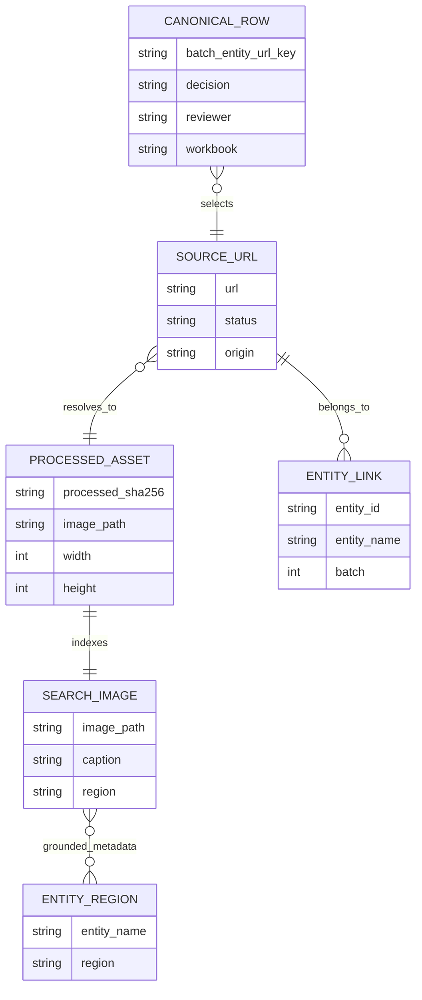

# Architecture and measurement boundaries

The capstone focuses on post-crawl image processing. The local corpus combines only URLs that the canonical Team 3 reviewed sheet marks as kept. A later recheck overrides its earlier final workbook. Candidate-sheet `x` values are not treated as bad-image labels because they can mean no additional image was needed.

```mermaid
flowchart LR
  W[Authorized final + recheck workbooks] --> C[Canonical rows by batch, entity, URL]
  C --> S[Selected reviewed-keep URLs]
  S --> D[Download or reuse matching local asset]
  D --> V[Decode and technical checks]
  V --> H[SHA-256 exact duplicate audit]
  H --> P[dHash candidate pairs]
  P --> R[Human review for uncertain pairs]
  H --> M[Corpus manifest with provenance]
  R --> M
  M --> I[Retrieval index]
  I --> A[Search API and web demo]
```

One source URL may be linked to several entities. The manifest retains all such links even when an image file is stored once. It records both the original URL and whether the processed WebP came from this project's downloader or an authorized local corpus. Imported assets carry a SHA-256 of the *processed WebP*, not a fabricated hash of unavailable original HTTP bytes. The two local transforms differ in resize and WebP quality, so their provenance stays visible.

Original-byte hashes and processed-byte hashes use separate storage namespaces (`images/<prefix>/` and `images/imported/<prefix>/`). Their hexadecimal values must never share a filename namespace: a source image served as WebP can have the same bytes as another pipeline's processed output, while those pipelines may store different final bytes. The importer verifies the processed checksum after hard-linking and the full corpus audit checks it again.

The processing decisions are deliberately narrow. HTTP/decode failure, corrupted files, and exact-byte duplicates can be measured mechanically. A dHash distance of at most four only creates a review candidate; visually different images can share a small distance. Existing human `x` labels mix incorrect entity, duplicates, watermark, inaccessible sources and other causes, so they are not ground truth for any individual safety or quality failure. Baselines trained on this mixed label stay experimental unless they meet a predeclared false-reject constraint on held-out entities.

## Local storage and checkpoints

`data/` contains company inputs, manifests, images and reports and is excluded from Git. `build_corpus.py` appends one result per attempted URL and emits `progress.json` every batch. It pauses on low disk or widespread DNS errors. `import_local_corpus.py` hard-links verified WebP files from an existing local corpus and writes `assembled_manifest.jsonl`; it does not alter the source project. `verify_assembled_corpus.py` checks every selected row, decodes each chosen WebP, checks its processed checksum, and reports the number of distinct processed hashes. Only that audited count can support the 80,000-image claim.

`build_processing_decisions.py` turns the assembled manifest into a reproducible
technical action file. Unavailable URLs go to retry/source review; missing or
invalid stored files go to quarantine; identical processed bytes reuse the
first asset; dHash candidates go to visual duplicate review; other valid files
pass the technical stage. None of these actions assert that a new crawl image
matches its entity or passes safety policy. Human keep labels remain distinct
from automatic actions in both the row output and aggregate report.

## Performance reporting

Measure download throughput, decode/hash throughput, image embedding throughput, and API latency separately. A network failure or rate limit changes download throughput but not local hash throughput. Report hardware, worker count, sample size, wall time, p50/p95 and error breakdown. Extrapolations to 10–100 million images must state assumptions about source availability, parallelism, storage and compute cost; they are not measured throughput at that scale.

Retrieval latency is measured at the API boundary on the full real-image index after warm-up. Report single intent, multi-intent and multi-hop cases separately, including requests that fail to find a grounded answer. Do not count synthetic repeated vectors as real indexed images.

## Retrieval behavior in the demo

The demo uses SQLite FTS5 over normalized entity names, captions, page titles,
region, and description. A single-intent query first requires all meaningful
terms to occur in an indexed row. If there is no hit, it backs off to short
contiguous term groups; it does not fall back to a single word from a longer
query. Candidate rows must also contain the original accented words used in
the matched group in their display metadata, avoiding obvious `hổ`/`hồ`
collisions. These rules reduce weak lexical matches but do not establish
semantic relevance. They avoid scoring most of the corpus for broad `OR`
queries while still returning a documented partial match.
The API shares a 2.5-second SQLite work budget across the parts of a query;
if it expires, it stops scanning and marks the response partial. This protects
the response budget from a broad FTS case but cannot prevent host scheduling,
container startup or image transfer delays outside the SQLite work budget.
The returned `bm25` score is a lexical rank, not an image embedding score.

A multi-intent query is split on Vietnamese `và`; each part is searched
separately and the result groups are interleaved with duplicate image URLs
removed. The response retains each intent group so the UI and benchmark can
inspect coverage. This is a lexical baseline, not a learned compositional
model.

The supported multi-hop form is “subject ở cùng tỉnh/địa bàn/vùng với reference
entity”. The API resolves the reference through the explicit `entity_region`
table, rejects ambiguous or absent region links, then searches the subject
within that region. Family relationships are absent from the source metadata;
the API returns an unsupported reason and no images for those queries rather
than inventing a relation. Other arbitrary hops are outside this baseline.

The 3-second benchmark measures HTTP request-to-JSON latency only. It does not
include thumbnail downloads or establish visual relevance. The deterministic
metadata-derived proxy cases must be supplemented with independent top-result
judgments before making a quality claim.
