# Architecture and measurement boundaries

The capstone focuses on post-crawl image processing. The local corpus combines only URLs that the canonical Team 3 reviewed sheet marks as kept. A later recheck overrides its earlier final workbook. Candidate-sheet `x` values are not treated as bad-image labels because they can mean no additional image was needed.

```mermaid
flowchart LR
  W[Authorized final + recheck workbooks] --> C[Canonical rows by batch, entity, URL]
  C --> S[Selected reviewed-keep URLs]
  S --> D[Download or reuse matching local asset]
  D --> V[Decode and technical checks]
  V --> H[SHA-256 exact duplicate audit]
  H --> P[dHash candidate pairs]
  P --> R[Human review for uncertain pairs]
  H --> M[Corpus manifest with provenance]
  R --> M
  M --> I[Retrieval index]
  I --> A[Search API and web demo]
```

One source URL may be linked to several entities. The manifest retains all such links even when an image file is stored once. It records both the original URL and whether the processed WebP came from this project's downloader or an authorized local corpus. Imported assets carry a SHA-256 of the *processed WebP*, not a fabricated hash of unavailable original HTTP bytes. The two local transforms differ in resize and WebP quality, so their provenance stays visible.

The processing decisions are deliberately narrow. HTTP/decode failure, corrupted files, and exact-byte duplicates can be measured mechanically. A dHash distance of at most four only creates a review candidate; visually different images can share a small distance. Existing human `x` labels mix incorrect entity, duplicates, watermark, inaccessible sources and other causes, so they are not ground truth for any individual safety or quality failure. Baselines trained on this mixed label stay experimental unless they meet a predeclared false-reject constraint on held-out entities.

## Local storage and checkpoints

`data/` contains company inputs, manifests, images and reports and is excluded from Git. `build_corpus.py` appends one result per attempted URL and emits `progress.json` every batch. It pauses on low disk or widespread DNS errors. `import_local_corpus.py` hard-links verified WebP files from an existing local corpus and writes `assembled_manifest.jsonl`; it does not alter the source project. `verify_assembled_corpus.py` checks every selected row, decodes each chosen WebP, checks its processed checksum, and reports the number of distinct processed hashes. Only that audited count can support the 80,000-image claim.

## Performance reporting

Measure download throughput, decode/hash throughput, image embedding throughput, and API latency separately. A network failure or rate limit changes download throughput but not local hash throughput. Report hardware, worker count, sample size, wall time, p50/p95 and error breakdown. Extrapolations to 10–100 million images must state assumptions about source availability, parallelism, storage and compute cost; they are not measured throughput at that scale.

Retrieval latency is measured at the API boundary on the full real-image index after warm-up. Report single intent, multi-intent and multi-hop cases separately, including requests that fail to find a grounded answer. Do not count synthetic repeated vectors as real indexed images.
