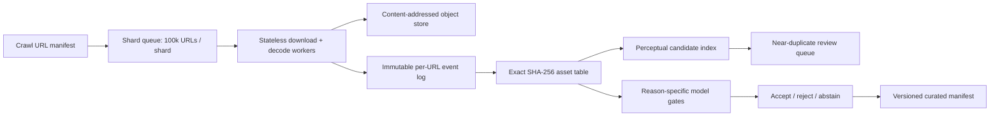

# Pain Point A: scale design and evidence boundary

The implemented local pipeline checks files, shares exact-byte assets and
produces a near-duplicate review queue. It has processed a real 80k+ corpus,
but **it has not automatically verified entity relevance, watermark, politics,
adult content or other safety categories**. The corpus was selected by human
reviewers. The architecture below is a proposed route to 10–100 million crawl
images, not a claim that this implementation has run at that scale.

Each input URL receives a stable key and an append-only result with source
status, checksum, image dimensions, model versions, reason scores and decision.
Workers acknowledge a shard only after its outputs and checkpoint are durable.
Retry transient network failures separately from content rejects. Store a
single asset per processed SHA-256 while preserving all URL→entity links.
Candidate near-duplicates are compared inside a bounded index/partition and
never deleted on dHash distance alone. A 100-million-row batch would comprise
1,000 shards at 100,000 rows each. The optional
`build_processing_decisions_streaming.py` prototype now streams manifest rows
in bounded Python batches and keeps exact-hash, path and candidate-key state
in a temporary SQLite database. Its local throughput must be measured
separately; it does not supply durable distributed checkpoints, a partitioned
perceptual index or a 100M benchmark.

The model gate is designed as three-way: auto-accept, auto-reject or abstain for
human review. Thresholds must be chosen on validation entities and assessed on
unseen test entities for each reason. The current mixed human `x` label cannot
be treated as a watermark or safety label. Until reason-specific labels and a
verified false-reject bound exist, those decisions remain abstentions. The
local classifier experiments are not enabled in production.

The reproducible local resource projection is generated with
`python scripts/project_processing_scale.py`. For `N` valid images, it computes
CPU machine-hours as `N / measured_cpu_images_per_second / 3600`, processed
storage bytes as `N × measured_processed_bytes_per_image`, and expected source
transfer as `N × pilot_source_bytes_per_valid_image`. These are linear
projections from **different samples**. They omit index overhead, retries,
model inference, human review and remote host throttling. The URL pilot's
observed rate is a network observation on one machine, not a capacity
guarantee. Cost in USD requires actual machine-hour, storage, network and model
rates; the generator leaves unknown rates blank rather than inventing a total.

The minimum evaluation before enabling an automated content reject is:

1. A reason-specific labeled set with positive and negative cases from the
   intended crawl distribution, split by entity and source domain.
2. Thresholds fixed on validation data, then a one-time holdout report of
   false rejection of good images, bad-image recall, abstention rate and
   uncertainty intervals per reason.
3. Throughput and peak memory for every enabled model, combined with measured
   download and storage costs. The slowest stage determines end-to-end capacity.
4. A shadow run on new crawl batches comparing machine actions with fresh human
   decisions before any automatic rejection is turned on.

These are acceptance gates for the proposed scale deployment. The capstone
currently demonstrates the deterministic technical stages and records why the
semantic/safety stage is not yet safe to activate.
